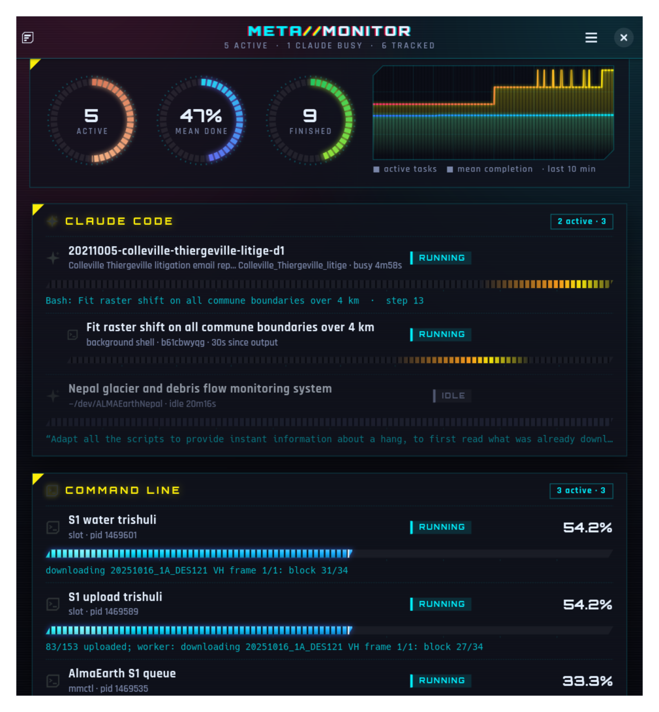
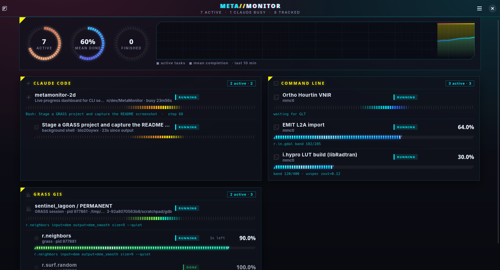

# META//MONITOR

<p align="center">
  
</p>

A GNOME (GTK 4 + libadwaita) dashboard that shows every progress bar on the
desktop in one place: your Claude Code sessions, GRASS GIS modules, wrapped
or piped CLI jobs, file copies started anywhere, and desktop applications.
It pairs btop's dense, segmented meters with Cyberpunk 2077 styling (see
[the brand guide](docs/brand/BRAND.md)). Meters, rings and the history chart
are GSK render nodes and paths, so GTK's GL/Vulkan renderer draws them on
the GPU.



## Install and run

```sh
sudo apt install ./dist/metamonitor_0.2.2_amd64.deb   # or, per user:
make install     # ~/.local, plus the ~/.bashrc and GRASS hooks
metamonitor      # or "MetaMonitor" in the GNOME overview
```

Debian 13 already has every dependency (`python3-gi`, `gir1.2-gtk-4.0`,
`gir1.2-adw-1`; `fonts-jetbrains-mono` is recommended). `make deb` builds the
package into `dist/` and `make test` runs the tests. `make shell-test`
checks the top-bar extension in a throwaway headless GNOME Shell (see
[Testing the top-bar extension](#testing-the-top-bar-extension)).

**Default hooks.** `make install`, and the app's first start, add two
marked blocks. Turn either off in the menu (*Enrolment*), or with
`mmctl bash disable` / `mmctl grass disable`:

- `~/.bashrc` (and `~/.zshrc`): `eval "$(mmctl shell-init)"`. In a terminal,
  rsync, wget, gdal_*, ogr2ogr, pip, uv, rclone and aria2c then report
  progress on their own.
- `~/.grass8/bashrc`: `export LD_PRELOAD=…/libmmgrass.so`, which GRASS loads
  for the shell, `--exec` and the GUI. Every module then reports its exact
  `G_percent()` progress (see below).

**Top bar.** Enable the *MetaMonitor* extension in GNOME Extensions; GNOME
Shell 46–49 loads new extensions after you log out and back in. Then run
`metamonitor --background`, or turn on *Keep running when closed*, so the
panel meter stays live.

**Help.** *Menu → Help → Bash* (also `metamonitor --guide=bash`) explains
every way to push a percentage into the app. Further pages cover GRASS GIS,
Python, Claude Code and the recognised formats.

## How things enrol

| Source | How | Setup |
|---|---|---|
| Claude Code sessions | `~/.claude/sessions/*.json` (status), transcript tail (current tool call, step count, last prompt, task list → %) | none |
| Claude background shells / Monitors | `/tmp/claude-$UID/*/<session>/tasks/*.output`, parsed like any CLI; `[exited with code N]` / `[killed]` give the result | none |
| Claude background jobs | `~/.claude/jobs/*/state.json` | none |
| File crunchers (cp, dd, tar, rsync, gzip, xz, zstd, sha256sum, gdal_translate, ffmpeg…) | `/proc/<pid>/fdinfo` offset ÷ input size, like Xfennec's `progress` | none; add names with `METAMONITOR_PROC_COMMANDS` |
| Desktop apps (Firefox/Chromium downloads, Transmission, Steam…) | `com.canonical.Unity.LauncherEntry.Update` D-Bus broadcasts | none |
| GRASS GIS sessions | mapset `.gislock` files (binary pid) and processes carrying `GISRC`; stale locks flagged | none |
| GRASS GIS modules | `libmmgrass.so` interposes `G_percent()`, `G_progress()` and `G_fatal_error()`, forwards them unchanged and writes a slot; Python scripts using `gs.percent()` too | the default GRASS hook |
| Any CLI that prints progress | `mmrun -- cmd args…` | wrap it |
| Chosen CLIs, every time | `eval "$(mmctl shell-init)"` in `~/.bashrc` defines wrapping functions | the default shell hook |
| Output you cannot wrap | `cmd 2>&1 \| mmctl pipe ID`, `mmctl tail ID logfile --pid PID` | — |
| Your own scripts | `mmctl set ID 42 -n "Name" -d "detail"`, or write a file into the spool | — |

### What counts as "standard progress"

`mmrun`, `mmctl pipe`/`tail` and the Claude background-task reader all use
the same parser (`metamonitor/parse.py`), which understands:

- `OSC 9;4` terminal progress sequences (systemd, cargo, pytest, winget…),
  including the error, paused and indeterminate states;
- `NN%` / `NN.N %` anywhere in a line (tqdm, rsync `--info=progress2`, wget,
  curl, pip, apt, GRASS `G_percent`, which rewrites the line with `\b`);
- `GRASS_INFO_PERCENT: NN` (`GRASS_MESSAGE_FORMAT=gui`);
- GDAL's `0...10...20...` counter and its `100 - done.`;
- `N/M` counters (`[ 12/340]`, `Step 3/7`), but not dates or paths.

`mmrun` runs the command on a pseudo-terminal, so the command still draws its
own bar in your terminal and window resizes are passed through. The slot ends
`done` (exit 0) or `failed` (with the exit code).

### The spool (the "slots")

`$XDG_RUNTIME_DIR/metamonitor/slots/` (override with `METAMONITOR_SPOOL`),
one file per task, replaced atomically:

```sh
echo 42 > "$(mmctl path)/my-job"                       # name = file name
echo '{"name":"LUT build","percent":30,"detail":"band 120/400","pid":1234}' \
    > "$(mmctl path)/lut"
```

`state` may be `running`, `paused`, `blocked`, `idle`, `done` or `failed`.
If `pid` is given and that process dies while the slot is still running, the
slot turns `failed`. A running slot with no pid that gets no update for 10
minutes turns `paused`. Finished slots stay visible for 2 minutes and their
files are deleted after a day. No daemon is needed: slots written while the
window is closed show up when it opens.

From Python, without importing anything:

```python
import json, os, pathlib
slot = pathlib.Path(os.environ["XDG_RUNTIME_DIR"], "metamonitor/slots/myrun")
slot.parent.mkdir(parents=True, exist_ok=True)
slot.write_text(json.dumps({"name": "My run", "percent": 12.5, "pid": os.getpid()}))
```

### Giving Claude a real percentage

A Claude session is shown as indeterminate (an animated sweep) with its
current tool call and step number. When the session uses its task list
(TaskCreate/TaskUpdate), the bar shows completed ÷ total tasks. For long
loops, Claude can also push a value itself, e.g. by adding this to a
project's `CLAUDE.md`: "for long jobs, report progress with
`mmctl set <id> <done> --of <total> -n <name>`".

## GRASS GIS details

- A session is shown as *project / mapset*, with the module that is currently
  running as its detail line, and each module as a child row.
- Modules report through the shim even with `--quiet`. Modules that finish in
  under a second get no row. A `G_fatal_error()` message turns the bar red
  and shows the error.
- `gs.percent()` runs `g.message -p`, so the shim credits that progress to the
  calling script instead of to the short-lived `g.message` process.
- Sessions that do not read `~/.grass8/bashrc` (`grass.script.setup.init()`,
  `grass.jupyter`) still show their modules, with progress estimated from how
  far they have read their largest input map. Start them with
  `LD_PRELOAD=/usr/lib/metamonitor/libmmgrass.so` for exact values.
- Stale `.gislock` files whose process is gone are listed, since they keep
  the mapset from opening. Locks from the last day get their own row with the
  `rm` command; older ones are grouped into one row.

## Testing the top-bar extension

`make shell-test` (or `tests/shell/run_nested_shell.sh [OUTDIR]`) starts a
headless `gnome-shell` on its own private D-Bus session with throwaway XDG
and home directories. It enables the extension from this source tree and
checks that the indicator is in the top bar and that its menu opens. It
saves a screenshot and the logs to `OUT` (`make shell-test OUT=dir`) or to a
temporary directory. Your desktop session is not touched.

Do not run `gnome-shell --headless` or `--nested` by hand for this. On a
private bus, gnome-shell starts its own `ibus-daemon`, which survives the test
shell. It then loses its bus, spins at about 35 % CPU and grows by gigabytes
of RAM. The script avoids it: it puts a no-op `ibus-daemon` first on `PATH`
(the test needs no input method), and on exit it kills every process still
attached to its private bus.

## Notes

- Notifications are sent when a task that ran for at least a minute
  finishes or fails, and when a Claude session goes from busy to waiting.
  Turn them off in the menu.
- `Ctrl+L` clears finished slots, `Ctrl+Q` quits.
- Under Wayland there is no system tray. Keep the window on a second
  workspace or monitor.

Licence: public domain ([Unlicense](LICENSE)). The bundled Orbitron and Rajdhani fonts are under the SIL Open Font License 1.1 (`data/fonts/OFL-*.txt`).
