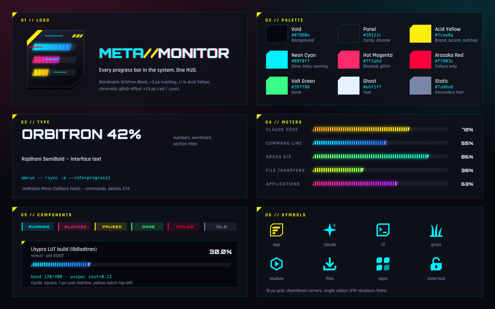

# MetaMonitor brand

MetaMonitor is a HUD for long jobs. The look combines btop's density and
segmented gradient meters with Cyberpunk 2077's interface language: a void
background, acid yellow as the brand colour, neon cyan for data, chamfered
corners, scanlines and a chromatic "glitch" offset.

## Logo

- **Mark**: a dark plate with two corners cut, holding three segmented
  meters (cyan, magenta, yellow) at different fill levels, a yellow cut-corner
  stripe and hazard ticks. Source:
  `data/icons/hicolor/scalable/apps/io.github.yannchemin.MetaMonitor.svg`.
- **Wordmark**: `META//MONITOR` in Orbitron Black with +3 px tracking. "META"
  is cyan, "//" acid yellow and "MONITOR" ghost white. Red and cyan copies sit
  behind it, offset by ±1.5–2 px.
- Keep at least the plate's cut-corner width of clear space around the mark.
  Never put the mark on yellow, and never recolour the meters.

## Palette

| Token | Hex | Use |
|---|---|---|
| Void | `#07080e` | Window background |
| Panel | `#10121c` | Cards, chrome |
| Acid Yellow | `#fcee0a` | Brand, accent colour, card notches, section titles |
| Neon Cyan | `#00f0ff` | Data, hairlines, running state |
| Hot Magenta | `#ff2a6d` | Blocked state, glitch |
| Arasaka Red | `#ff003c` | Failure only |
| Volt Green | `#39ff88` | Done |
| Ghost | `#e6f1ff` | Text |
| Static | `#7a86a8` | Secondary text |

Meter gradients, one per source: Claude `#ff9f1c→#fcee0a`, CLI
`#00f0ff→#2f6bff`, GRASS `#7cff4f→#00e5c7`, files `#fcee0a→#7cff4f`, apps
`#ff2a6d→#b026ff`. The tokens live in `metamonitor/brand.py` and are mirrored
as `@define-color` in `metamonitor/ui/style.css`.

## Type

- **Orbitron** (OFL): numbers, the wordmark and section titles, in capitals.
- **Rajdhani** SemiBold/Bold (OFL): interface text.
- **JetBrains Mono** (fallback Hack): commands, details and ETAs.

Orbitron and Rajdhani ship in `data/fonts/`. The app loads them into its own
fontconfig set, so nothing is installed system-wide.

## Shapes and motion

- Cards are square, with a 1 px cyan hairline and a yellow triangular notch
  at the top left.
- Meters are parallelograms (`/____/`) cut into btop blocks: a 7 px pitch with
  2 px gaps. They have a soft bloom and a bright leading edge.
- Running meters carry a passing sheen. Unknown progress shows as a scanner
  sweep.
- Status pills are flat, with a 3 px left rule in the state colour.
- Rings are dashed HUD gauges with an outer tick ring.

## Symbols

Symbolic icons are drawn on GNOME's 16 px grid with chamfered corners, in a
single colour that GTK recolours: app, claude (agent), cli, grass, module,
files, apps and stale lock. They live in `data/icons/symbolic/`.

Regenerate the board with `python3 docs/brand/make_board.py`, then render it
with Inkscape using a fontconfig file that includes `data/fonts`.
